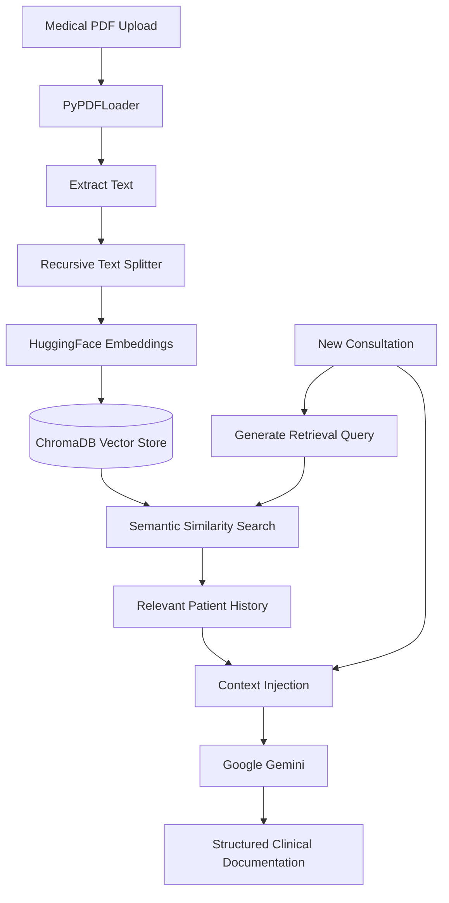
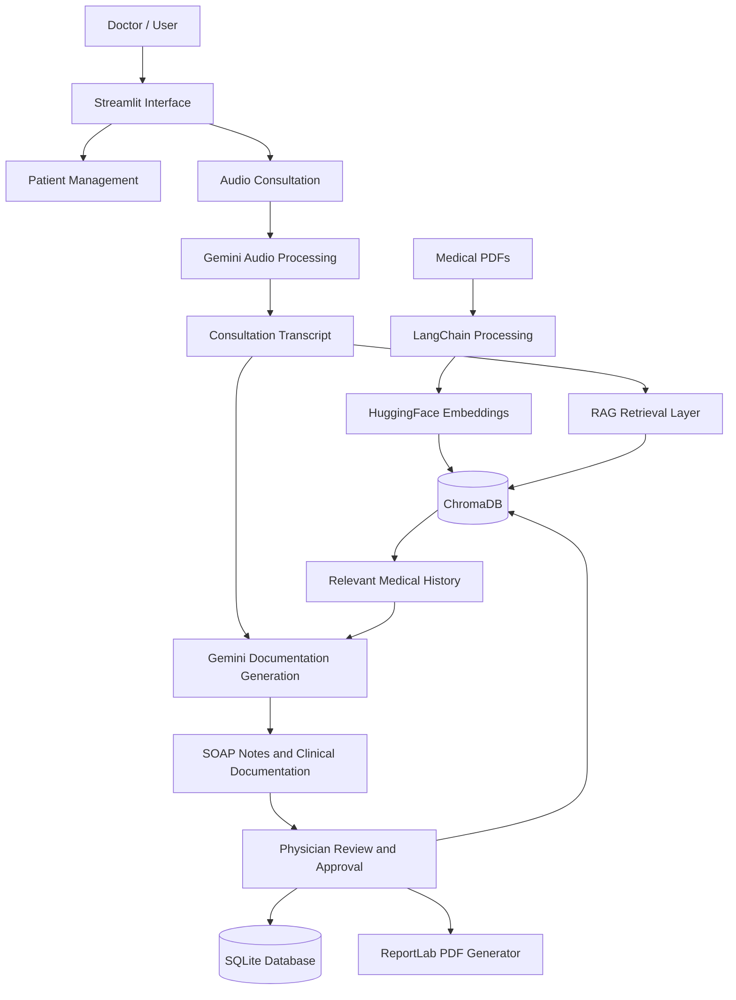

# NexEHR Copilot 🩺

### AI-Powered Clinical Documentation & EHR Assistant

NexEHR Copilot is an AI-powered clinical documentation assistant designed to simplify medical documentation by transforming doctor-patient consultation audio into structured clinical records. By combining **Google Gemini, LangChain, Retrieval-Augmented Generation (RAG), and ChromaDB**, the application generates context-aware clinical documentation using relevant patient medical history.

The system integrates audio transcription, AI-generated SOAP notes, historical medical record retrieval, patient record management, and professional PDF report generation into a unified application.

---

## 🚀 Features

- **AI Audio Transcription** – Convert doctor-patient consultation audio into text using Google's Gemini API.
- **Automated Clinical Documentation** – Generate structured SOAP notes (Subjective, Objective, Assessment, and Plan) from consultation transcripts.
- **RAG-Based Medical History Retrieval** – Retrieve relevant information from previously uploaded patient medical records using semantic similarity search.
- **Context-Aware AI Generation** – Provide Gemini with consultation transcripts and relevant patient history to generate contextualized clinical documentation.
- **Medical Document Processing** – Upload medical PDFs, extract text, split documents into chunks, generate embeddings, and index them for retrieval.
- **Patient Management** – Register patients, maintain demographic information, and manage consultation records.
- **Treatment & Follow-up Insights** – Generate draft treatment plans, investigation suggestions, patient instructions, and follow-up recommendations for physician review.
- **Consultation Approval Workflow** – Review, edit, save, and approve AI-generated documentation.
- **Clinical PDF Reports** – Generate structured, professional clinical reports using ReportLab.
- **Persistent Storage** – Use SQLite for structured patient and consultation data and ChromaDB for vector-based medical document retrieval.

---

## 🧠 AI & RAG Architecture

NexEHR Copilot uses Retrieval-Augmented Generation (RAG) to provide Gemini with relevant patient-specific historical information during clinical documentation generation.

### RAG Pipeline

1. **Document Ingestion** – Medical PDF documents are loaded using LangChain's `PyPDFLoader`.
2. **Text Chunking** – Documents are divided into smaller chunks using `RecursiveCharacterTextSplitter`.
3. **Embedding Generation** – HuggingFace Sentence Transformers convert text chunks into vector embeddings.
4. **Vector Storage** – Document embeddings and metadata are stored persistently in ChromaDB.
5. **Semantic Retrieval** – Relevant historical information is retrieved using similarity search based on the current consultation.
6. **Patient Filtering** – Metadata filtering restricts retrieval to records belonging to the selected patient.
7. **Context Injection** – Retrieved information is combined with the consultation transcript.
8. **AI Generation** – Gemini processes the transcript and historical context to generate structured clinical documentation.

### RAG Workflow



---

## 🛠️ Tech Stack

| Technology | Purpose |
|---|---|
| Python | Core programming language |
| Streamlit | Interactive application interface |
| Google Gemini API | Audio transcription and clinical documentation generation |
| LangChain | Document processing, text splitting, embedding and RAG integration |
| HuggingFace Sentence Transformers | Text embedding generation |
| ChromaDB | Persistent vector storage and semantic retrieval |
| SQLite | Patient and consultation database |
| PyPDFLoader | Medical PDF text extraction |
| RecursiveCharacterTextSplitter | Document chunking |
| ReportLab | Clinical PDF report generation |

---

## 🏗️ System Architecture



---

## 📋 Clinical Documentation Output

The AI-generated documentation can include:

- Chief Complaint
- Clinical Summary
- Subjective
- Objective
- Assessment
- Plan
- Relevant Medical History
- Current Medications
- Allergies
- Treatment Plan
- Investigations
- Patient Instructions
- Follow-up Recommendations
- Differential Diagnoses
- ICD-10 Codes
- Risk Indicators
- Red Flags
- Missing Information

All generated content is intended to be reviewed and validated by a physician before approval.

---

## 📂 Project Structure

```text
NexEHR-Copilot/
│
├── app.py                  # Streamlit application and UI
├── ai_service.py           # Gemini AI integration
├── rag.py                 # RAG pipeline and ChromaDB operations
├── db.py                 # SQLite database operations
├── pdf_gen.py             # Clinical PDF report generation
│
├── chroma_db/             # Persistent vector database
├── generated_reports/      # Generated clinical PDF reports
├── uploads/               # Uploaded files (if configured)
│
├── .env                   # Environment variables and API keys
├── .gitignore
├── requirements.txt
└── README.md
```

---

## ⚙️ Installation & Setup

### 1. Clone the repository

```bash
git clone https://github.com/YOUR_USERNAME/NexEHR-Copilot.git
cd NexEHR-Copilot
```

### 2. Create a virtual environment

**Windows:**

```powershell
python -m venv venv
venv\Scripts\activate
```

**Linux/macOS:**

```bash
python -m venv venv
source venv/bin/activate
```

### 3. Install dependencies

```bash
pip install -r requirements.txt
```

### 4. Configure environment variables

Create a `.env` file in the project root.

```env
GEMINI_API_KEY=your_gemini_api_key
GEMINI_MODEL=your_supported_gemini_model
TRANSCRIPTION_MODEL=your_supported_gemini_model
DOCTOR_NAME=Dr. Chopper
```

Replace the placeholders with your actual configuration. Never commit API keys or credentials.

### 5. Run the application

```bash
streamlit run app.py
```

The application will open in your browser, usually at:

```text
http://localhost:8501
```

---

## 🔄 Application Workflow

1. Register a patient or select an existing patient.
2. Upload historical medical documents in PDF format.
3. Extract, chunk, embed, and store the documents in ChromaDB.
4. Upload or record consultation audio.
5. Process audio using Gemini and obtain the transcript.
6. Review and edit the transcript.
7. Retrieve relevant historical medical information using RAG.
8. Pass the consultation transcript and retrieved context to Gemini.
9. Generate structured clinical documentation and SOAP notes.
10. Review and modify the AI-generated content.
11. Save the consultation as a draft.
12. Approve the consultation after physician review.
13. Generate and download the clinical PDF report.

---

## 💾 Database Design

### SQLite

Used for structured and persistent storage of:

- Patient details
- Consultation transcripts
- SOAP documentation
- Clinical summaries
- Treatment plans
- Consultation status
- Approval timestamps
- PDF report paths

### ChromaDB

Used for vector-based storage of:

- Uploaded medical document chunks
- Approved consultation documentation
- Patient-specific metadata
- Text embeddings for semantic retrieval

SQLite and ChromaDB serve different purposes: SQLite manages structured records, while ChromaDB enables semantic search over medical information.

---

## 🔒 Safety & Limitations

- NexEHR Copilot is an assistive clinical documentation tool, not an autonomous diagnostic system.
- AI-generated diagnoses, medication suggestions, investigations, and treatment plans are drafts.
- Physicians must review and approve documentation before it is considered finalized.
- AI-generated medication suggestions should not automatically be treated as a patient's active medication list.
- Patient-specific metadata filtering is used during historical retrieval.
- The quality of generated documentation depends on audio quality, transcript accuracy, available medical records, and model output.
- This project is a prototype and should not be used as a replacement for validated clinical systems or professional medical judgment.

---

## 🔮 Future Enhancements

- Integration with standardized EHR systems.
- Support for more document types.
- Improved multilingual audio transcription.
- Advanced medical history summarization.
- Role-based authentication and authorization.
- Enhanced privacy and data security.
- Clinical evaluation and accuracy testing.
- Improved source-level citations for retrieved patient history.

---

## 👨‍💻 Developed With

Built using Python, LangChain, Google Gemini, ChromaDB, HuggingFace, Streamlit, SQLite, and ReportLab.

---

**NexEHR Copilot — Making Clinical Documentation Smarter, Faster, and Context-Aware.**